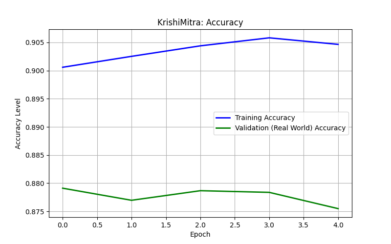

# 🌱 Krishi Mitra

**AI-powered plant disease detection for farmers.** Upload a photo of a crop leaf and get an instant diagnosis, no agronomist visit required.

[](LICENSE)
[](https://krishimitra-team-app.hf.space/)

**🔗 Live demo:** https://krishimitra-team-app.hf.space/

---

## Why this project?

Crop diseases cause major yield losses for smallholder farmers, especially where expert help is far away or slow to reach. Krishi Mitra puts a first-pass diagnosis in a farmer's hands using nothing but a phone photo, so problems can be caught early.

## Features

-  Upload a leaf image and get a disease prediction in seconds
-  Deep learning (CNN) model trained on plant leaf images
-  Simple web interface built with Flask
-  Dockerized for easy, reproducible deployment
-  Deployed on Hugging Face Spaces

## Model performance

The training notebook (`Crop_detection.ipynb`) covers data preparation, training and evaluation.



## Tech stack

| Area | Tools |
|---|---|
| Model | TensorFlow / Keras |
| Backend | Python, Flask |
| Frontend | HTML, CSS, JavaScript (`templates/`, `static/`) |
| Deployment | Docker, Hugging Face Spaces |

## Project structure

```
krishi-mitra/
├── app.py                 # Flask app: loads the model and serves predictions
├── plant_model.h5         # Trained model weights
├── Crop_detection.ipynb   # Training and evaluation notebook
├── accuracy_graph.png     # Training accuracy plot
├── templates/             # HTML templates
├── static/                # CSS, JS, images
├── requirements.txt       # Python dependencies
├── Dockerfile             # Container setup
└── LICENSE                # MIT
```

## Getting started

### Run locally

```bash
git clone https://github.com/Harshal-2006/krishi-mitra.git
cd krishi-mitra

python -m venv venv
source venv/bin/activate        # Windows: venv\Scripts\activate

pip install -r requirements.txt
python app.py
```

Then open the local address printed in your terminal (typically `http://127.0.0.1:5000`).

### Run with Docker

```bash
docker build -t krishi-mitra .
docker run -p 7860:7860 krishi-mitra
```

<!-- TODO: make sure the port above matches the one in your Dockerfile / app.py -->

## How it works

1. The user uploads a leaf image through the web UI.
2. The image is resized and normalized to match the model's training input.
3. The CNN (`plant_model.h5`) predicts the most likely disease class.
4. The result is shown back to the user.

## Roadmap

- [ ] Hindi and Marathi support for results
- [ ] Treatment and prevention advice for each detected disease
- [ ] Confidence scores and top-3 predictions
- [ ] Unit tests and CI with GitHub Actions
- [ ] Support for more crops and diseases
- [ ] Mobile-friendly / PWA experience


## License

Released under the [MIT License](LICENSE).

## Author

**Harshal Shirsat**, [@Harshal-2006](https://github.com/Harshal-2006)

If you find this useful, consider giving it a ⭐
